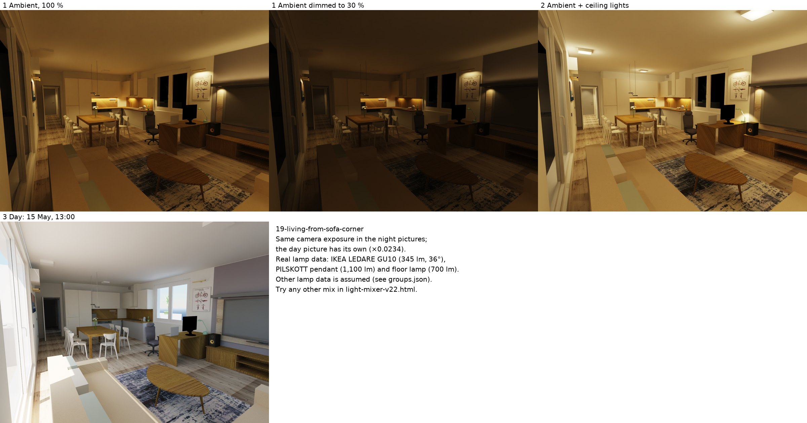

# Hrnetička flat: lighting study

Where should the wall lights go before the electrician drills? This project renders each lighting plan for a flat in Hrnetička street, Zagreb, with real light units and compares them room by room.

**See it in the browser: https://zsvedic.github.io/Hrneticka-flat/**

The page has the comparison sheets, the lux table and an interactive light mixer with three light groups (ambient, ceiling, day) in every view. It works on a phone too.

## What is in here

| Path | What |
|---|---|
| `Renders/blender-lighting/` | Current results (v22): 16 comparison sheets, `light-mixer-v22.html`, `luxmaps-v22.png`, `lux_table-v22.md`. Earlier rounds are in the git history. |
| `Hrneticka-v22.sh3d` | The Sweet Home 3D model (open with Sweet Home 3D 7) |
| `Claude-vectors/` | Floor plan, the wall-light points draft, design notes, and the files for the electrician in Croatian (`Hrneticka-elektricar-v22.*`: outlet list and a schematic with cable routes) |
| `Claude-tools/` | Scripts that build each model version and export it |
| `Claude-tools/blender/` | The Blender pipeline: lamp data, scene builder, comparison sheets, light mixer |
| `journal.md`, `AGENTS.md` | Work journal and working rules; the project was built with Claude |

## How it works

1. The flat is modelled in Sweet Home 3D. That model is the only source of truth: walls, furniture and every lamp position live there.
2. `Claude-tools/ExportObj.java` exports the model, and `blender/make_lights.py` reads the lamp positions from it.
3. `blender/s15_blender.py` rebuilds a Blender scene from scratch, gives each lamp its lumens, colour temperature and beam angle, adds sun and sky for the day scene, and renders each light group with Cycles. `blender/rerender.py` re-renders only the views a model change affects.
4. `blender/mix.py` turns the renders into comparison sheets, lux maps and the light mixer page; `make_site.py` writes the landing page.

Nothing in Blender is edited by hand, so a change in the model is one rebuild away from new pictures.

## Reading the results

- Lux values are measured in the render on floors and furniture tops. The light units were checked against a test scene with a known answer.
- Lamp strengths are assumptions except where a real product was chosen, so treat the numbers as a comparison between presets.
- All pictures use one fixed camera exposure. Your eye adapts, so a real room looks somewhat brighter than a dim picture suggests.

## Running it yourself

The scripts expect Sweet Home 3D's own `.jar` files in `Claude-tools/jars/`. They are not included here; copy them from a Sweet Home 3D 7 installation. Rendering needs Blender 5 and was run on an Apple M4, at about 30 seconds per view and light group (64 samples).
